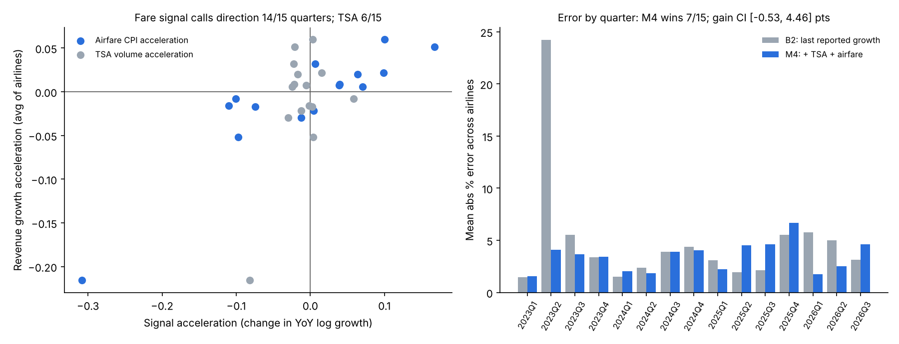

# Airline Revenue Nowcasting from Public Alternative Data

Can free government data predict U.S. airline quarterly revenue before the company reports?
This project builds a point-in-time nowcast for 6 airlines (DAL, UAL, AAL, LUV, ALK, JBLU)
from TSA checkpoint volumes and the BLS airline-fare CPI, and tests it walk-forward against
naive baselines.

**Short answer:** passenger volume (TSA) adds no reliable information beyond last-reported
growth. The airline-fare CPI correctly calls the **direction** of revenue-growth
acceleration in 14 of 15 quarters (p < 0.001), but its improvement in forecast **error** is
not statistically significant once observations are clustered by quarter.



## Data (all real, all public, provenance logged with SHA-256)

| Source | Series | Coverage | File |
|---|---|---|---|
| TSA | Daily checkpoint travel numbers | 2019-01-01 to 2026-11-01 (2,862 days, no gaps) | `data/processed/tsa_daily.csv` |
| SEC EDGAR XBRL | Quarterly total revenue, first-filed value and filing date | Q1 2018 to Q3 2026 (AAL, ALK to Q2 2026) | `data/processed/sec_quarterly_revenue.csv` |
| BLS | CPI-U airline fares, NSA (CUUR0000SETG01) | 2016-01 to 2026-09 (Oct 2025 not published) | `data/processed/bls_airfare_monthly.csv` |

Provenance files: `data/processed/*_provenance.csv`.

## Method

Nowcast date for quarter *q* = the day after the quarter ends: TSA data for the full quarter
is public, the company has not reported, and only months 1-2 of the quarter's CPI are
published.

- **Target:** revenue YoY log growth, *y* = log(Rev_q / Rev_q-4)
- **Signals:** TSA volume YoY log growth (*x*); airline-fare CPI YoY log growth, months 1-2 only (*f*)
- **Point-in-time rules (enforced by tests):**
  - a model trains only on quarters whose revenue was filed before the nowcast date
  - each quarter keeps its first-filed revenue value, not later restatements
  - a CPI month is used only after its publication date (assumed the 20th of the following month)
  - Q4 is derived as fiscal year minus Q1-Q3, dated to the 10-K filing

| Model | Definition |
|---|---|
| B1 | Seasonal naive: Rev_q = Rev_q-4 |
| B2 | Last-reported growth carried forward |
| M1 | Pooled OLS: y = a + b·x |
| M2 | M1 + last-reported growth |
| M3 | B2 + b·Δx (change in TSA growth) |
| M4 | B2 + b·Δx + c·Δf (change in TSA and fare growth). **Pre-committed final variant.** |

All six variants are reported; no variant was dropped after seeing results.

## Results

Evaluation window: Q1 2023 to Q3 2026 (post-COVID normalization). 84 airline-quarters
across 15 calendar quarters. Alaska's 4 quarters affected by the Hawaiian Airlines
acquisition are excluded.

| Model | MAPE | Median APE | Bias |
|---|---|---|---|
| B1 seasonal naive | 7.42% | 5.24% | −6.46% |
| B2 last-reported growth | 5.02% | 3.31% | +1.47% |
| M1 TSA regression | 7.55% | 6.12% | +3.02% |
| M2 TSA + carry | 7.25% | 5.60% | +3.36% |
| M3 B2 + ΔTSA | 4.95% | 4.04% | +0.45% |
| **M4 B2 + ΔTSA + Δfare** | **3.39%** | **2.97%** | **−0.24%** |

Quarter-clustered inference (`src/robustness.py`). TSA and CPI are national signals, so all
airlines share one signal value per quarter; the effective sample is 15 quarters, not 84.

| Test | Result |
|---|---|
| M4 vs B2 mean APE gain | 1.45 pts, 95% block-bootstrap CI [−0.53, 4.46] |
| Quarters where M4 beats B2 | 7 of 15 (sign-test p = 0.70) |
| Fare CPI calls direction of revenue-growth acceleration | **14 of 15 quarters (p < 0.001)** |
| TSA calls direction | 6 of 15 (p = 0.85) |

### What this means

1. **The full-sample correlation is a trap.** Over 2020-2026, TSA YoY growth correlates
   0.984 with airline revenue growth, but that is the COVID collapse and recovery. In the
   2023-2026 evaluation window the correlation falls to 0.372, while the fare CPI holds at
   0.790. A backtest that includes 2020-2022 would overstate TSA's value.
2. **Revenue growth in 2026 is a price story.** Delta's Q3 2026 revenue rose 21% YoY while
   TSA volume fell 3%. Volume alone points the wrong way.
3. **M4's average-error gain is fragile.** Much of it comes from Q2 2023, where B2 carried
   forward a post-Omicron rebound growth rate and missed by 24.2% (M4: 4.1%). M4 overreacts
   in Q2-Q3 2025, when fare swings were much larger than the revenue response.
4. **Usable output:** a quarter-level direction call (acceleration vs deceleration),
   not a point estimate.

## Limitations

- **TSA vintage:** archived TSA years carry TSA's note that numbers were revised (Known
  Crewmembers, late flights). Only 2026 is a first-print vintage, so the backtest uses some
  data that was not available in real time. Its size could not be measured without archived
  first prints.
- **Small effective sample:** 15 evaluation quarters. Results can change with a few more.
- **National signals:** neither TSA nor CPI distinguishes between airlines. Carrier-level
  BTS T-100 traffic would address this but was not ingested.
- **Guidance benchmark not done:** comparing against management guidance requires 8-K
  earnings releases, which were not collected.
- **As-of date:** revenue is treated as public on its 10-Q/10-K filing date. Earnings press
  releases can come out earlier, so training sets are slightly conservative (no leakage
  risk, possibly less data).

## Run

```
pip install pandas numpy openpyxl matplotlib pytest
python src/ingest_tsa.py
python src/ingest_sec.py
python src/ingest_bls.py
python src/backtest.py
python src/robustness.py
python -m pytest -q          # 8 point-in-time and data-integrity tests
```

Related docs: [dataset scorecard](docs/dataset_scorecard.md) ·
[compliance memo](docs/compliance_memo.md) · [PM research note](docs/pm_research_note.md)
